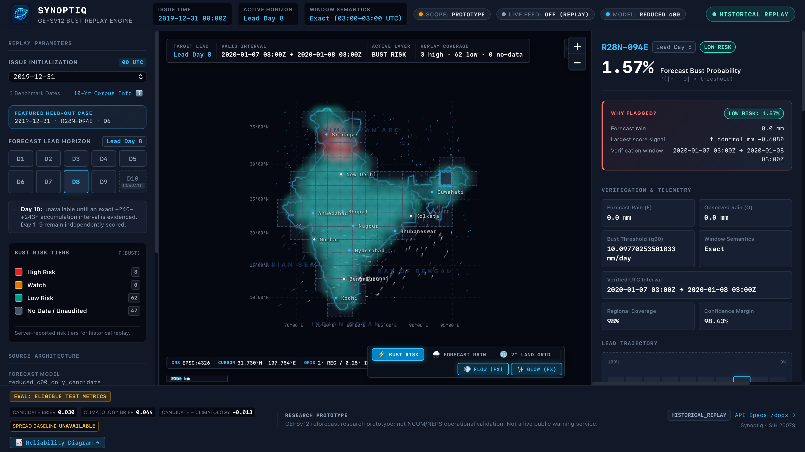
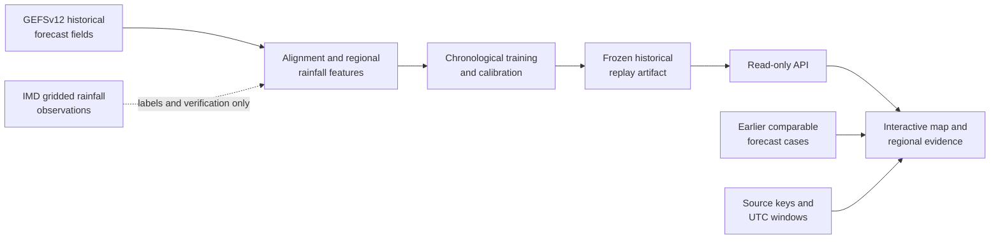

<div align="center">


# Synoptiq

### A replayable view of where a rainfall forecast was most likely to be wrong

Built by HackTastic 6ix for Smart India Hackathon 2026 · SIH26079 · Team ID **178497**

[](docs/SYNOPTIQ.md)
[](docs/SYNOPTIQ.md)
[](submission/README.md)
[](submission/README.md)
[](docs/SYNOPTIQ.md)

[Presentation](submission/README.md#presentation) · [Demo video](submission/README.md#demo-video) · [Project reference](docs/SYNOPTIQ.md)

</div>

## What is Synoptiq?

Synoptiq is a research dashboard for evaluating the reliability of historical medium-range rainfall forecasts over India. For each 2° land region and lead day, it computes the probability that the forecast incurs an unusually large error (defined as a **forecast bust**), alongside the model evidence supporting that estimate.

Medium-range numerical weather prediction models generally exhibit skill, but individual forecasts can develop large errors that ensemble spread does not indicate. Synoptiq identifies which region and lead day contain high estimated bust risk and provides the model evidence for that assessment.

The system operates as a historical replay interface. It is not an operational warning service and does not generate new numerical forecasts.

## The dashboard



*Synoptiq presents a regional bust-risk map alongside the selected region's probability, evidence, verification window, and forecast context.*

<p align="center">
  <a href="assets/screenshots/"><b>View more screenshots</b></a><br>
  <sub>Lead-day views, forecast-rain and land-grid layers, evidence cards, Day-10 handling, data splits, model roadmap, and reliability diagram.</sub>
</p>

## What can you explore?

- A spatial map of forecast bust risk across supported Indian land regions.
- Forecast rainfall, observed rainfall, and region-specific bust error thresholds.
- Model score contributions and strictly prior comparable forecast cases.
- The exact verification window and source provenance for each replayed record.
- Held-out evaluation metrics and the empirical reliability diagram.
- A read-only API providing GeoJSON map data, regional query results, and evaluation payloads.

The included replay covers three held-out forecast initialization dates: **2018-01-01**, **2019-01-01**, and **2019-12-31**. Lead days 1-9 are supported. Day 10 is intentionally marked as unavailable because the source archive does not provide the accumulation interval required for exact verification alignment.

## Run the replay

The repository includes the compressed historical replay bundle, allowing the dashboard to run immediately after cloning without external data downloads, GPU hardware, or API keys.

**Prerequisites:** Python 3.11 or 3.12, Node.js 20+, and `make`.

```bash
git clone https://github.com/kan9667/synoptiq.git
cd synoptiq
python3.11 -m venv .venv
source .venv/bin/activate
python -m pip install -e '.[dev]'
make web
make api
```

Open http://127.0.0.1:8000/ in a browser. Interactive OpenAPI documentation is available at http://127.0.0.1:8000/docs.

To verify system functionality, query the API endpoints or execute the test suite:

```bash
curl http://127.0.0.1:8000/health
curl "http://127.0.0.1:8000/v1/region/R28N-094E?init=2019-12-31&lead=6"
make smoke
make test
```

The `/health` endpoint returns `"data_mode": "historical_replay"`.

### Windows

`source .venv/bin/activate` and `make` are not available natively in Windows shells. Use one of the following configurations:

**Option A (WSL, recommended):** Run all commands above unchanged inside a WSL terminal.

**Option B (PowerShell or Command Prompt with native Python):**

```powershell
git clone https://github.com/kan9667/synoptiq.git
cd synoptiq
python -m venv .venv
.venv\Scripts\activate
pip install -e ".[dev]"
python scripts/build_web.py
python scripts/serve.py
```

**Option C (conda, also resolves eccodes/cfgrib on Windows):**

```powershell
conda env create -f environment.yml
conda activate synoptiq
python scripts/build_web.py
python scripts/serve.py
```

> `eccodes` and `cfgrib` do not provide official pip wheels for Windows. If installation issues occur with Option B, use Option C (conda).

## How to read a bust-risk result

A high bust probability does not indicate heavy rainfall or an operational severe weather warning. It indicates that the forecast accumulation for that region and lead day carries an elevated risk of differing from observed rainfall by an unusually large margin, through either overforecasting or underforecasting.

Synoptiq ingests the GEFSv12 control forecast available at issue time and evaluates it against IMD gridded rainfall after the verification window concludes. A bust occurs when the absolute forecast error exceeds a threshold calibrated on earlier years for the same region, season, and lead interval (subject to a 10 mm/day minimum). Observations are used solely for retrospective label verification, never as inputs to the forecast-time probability model.

The *Why flagged?* panel displays feature contributions to the model score. These values reflect model feature attribution, not a physical meteorological proof. Comparable cases shown alongside are strictly earlier forecast runs with their observed verification outcomes.

| Risk tier | Bust probability |
| --- | --- |
| Low | Below 30% |
| Watch | 30% to under 50% |
| High | 50% or more |
| No data | Day 10, or a region with under 80% IMD grid coverage |

These tiers serve as analytical categories for inspection, not official meteorological warnings.

### Example

Region **R28N-094E** (centered at 28°N, 94°E), forecast initialized on **31 December 2019, 00 UTC**. Select *Featured held-out case* in the dashboard to load this case.

| Metric | Day 1 | Day 5 | Day 6 |
| --- | ---: | ---: | ---: |
| Bust probability | 1.54% | 28.83% | **65.44%** |
| Forecast rainfall | 0.02 mm | 13.03 mm | **20.16 mm** |
| Observed IMD rainfall | 0 mm | 12.27 mm | **5.07 mm** |
| Absolute error | 0.02 mm | 0.76 mm | **15.09 mm** |
| Outcome (threshold 10 mm) | No bust | No bust | **Bust** |

Estimated bust probability increases with lead time. For Day 6, the forecast overpredicts observed rainfall by 15.09 mm, exceeding the 10 mm threshold. Aggregate model performance across the full test set is reported below.

### Time alignment and regions

IMD daily rainfall accumulations span 03:00 UTC to 03:00 UTC (08:30 IST to 08:30 IST), whereas GEFS forecasts initialize at 00:00 UTC. Each forecast lead day is aligned to an exact 03Z-to-03Z accumulation interval computed by aggregating forecast steps:

```text
IMD date label D      ->  [D - 1 day 03:00Z, D 03:00Z)
GEFS 00 UTC, lead L   ->  [init + (24L - 21) h, init + (24L + 3) h)
```

This alignment was verified against raw archive files: for the 2018-08-01 run at 20°N, 78°E, eight 3-hour forecast steps sum to 8.24 mm, matching the pipeline calculation. Day 10 requires an accumulation slice from +240 h to +243 h, but the archive provides only a +240 h to +246 h step; Day 10 is therefore left unscored rather than approximated.

The fixed 2° grid comprises 112 cells covering the Indian landmass. A cell is scored only if at least 80% of its contained IMD grid points report data: 65 regions qualify, and 47 peripheral regions are marked as no data. Region identifiers designate cell centers (for example, R28N-094E is centered at 28°N, 94°E); they do not correspond to administrative districts.

## Architecture

The system forms a reproducible pipeline from numerical forecast archives to regional risk assessments. Every served probability retains its model version, timing metadata, and data provenance.



The dashed connector indicates where IMD observational data enters the workflow: observations establish historical ground truth labels and verify test predictions, but never enter the model feature set. The model trains exclusively on earlier periods. Once a forecast verification window elapses, the corresponding observation verifies the forecast outcome without influencing the probability generated at issue time.

**Built with:** Python, xarray, cfgrib/ecCodes, pandas, Parquet, LightGBM, scikit-learn, FastAPI, Pydantic, Vite, Leaflet.

**Design rationale.** A gradient-boosted decision tree on tabular regional features executes within standard CPU constraints, uses named meteorological features, and supports chronological validation and probability calibration. A dense spatial architecture (such as U-Net) was omitted because it requires significantly higher training sample counts and storage while providing less feature-level interpretability. Comparable cases are retrieved directly from historical runs with known outcomes rather than through an opaque latent embedding.

## Results in this replay

The reduced LightGBM candidate model was evaluated on held-out 2018-2019 test data (427,050 eligible Day 1-9 regional forecasts):

| Model | Brier score |
| --- | ---: |
| Historical climatology baseline | 0.04359 |
| Synoptiq calibrated candidate | **0.03049** |

A lower Brier score indicates superior probabilistic accuracy. The calibrated model achieves a 30% reduction in Brier score relative to the climatology baseline on this historical task. Training utilized 2010-2015 data, probability calibration utilized 2016-2017 data, and 2018-2019 data was reserved exclusively for evaluation.

Forecast busts occurred in 4.74% of test cases. The uncalibrated model scored 0.02949, indicating that Platt scaling did not lower the Brier score on this test partition, and the empirical reliability curve shows remaining calibration error. An ensemble spread baseline and additional metrics (such as PR-AUC) are planned for subsequent iterations. Full methodology, data audit records, and evaluation details are documented in [docs/SYNOPTIQ.md](docs/SYNOPTIQ.md).

## Data and availability

The web dashboard consumes a verified, compressed replay artifact stored at `artifacts/replay/reduced_c00_replay.json.gz`. The file is checked into the repository and read directly by the FastAPI backend.

Forecast fields originate from the [NOAA GEFSv12 reforecast archive](https://registry.opendata.aws/noaa-gefs-reforecast/) (2010-2019, 00 UTC), and ground truth observations originate from [IMD 0.25° gridded rainfall](https://imdpune.gov.in/cmpg/Griddata/Rainfall_25_NetCDF.html). Raw source files are not committed; they are required only when regenerating the dataset shards or creating new replay slices.

The research study processed 3,652 daily forecast issue dates (2010-2019), yielding 4,090,240 aligned region-lead records. Approximately 98 GB of forecast data was streamed through a resumable pipeline operating within an 8 GiB local disk budget: each archive file was checksum-validated, converted to an intermediate Parquet shard, and deleted. Refer to [data/README.md](data/README.md) for data workspace policies.

## Repository guide

| Location | Content |
| --- | --- |
| `web/` | Interactive frontend dashboard (Vite, Leaflet). |
| `src/bust/` | Core package: data alignment, feature extraction, model logic, and FastAPI service. |
| `artifacts/replay/` | Bundled historical replay data (`reduced_c00_replay.json.gz`) and schema metadata. |
| `config/` | Configuration files for label policies, temporal splits, and 2° grid geometries. |
| `scripts/` | Executable entry points supporting Makefile workflows. |
| `tests/` | Unit, integration, leakage, and API contract test suite. |
| `assets/screenshots/` | Dashboard interface captures and documentation figures. |
| `submission/` | Project presentation deck, demo video links, and submission index. |
| `docs/SYNOPTIQ.md` | Complete methodology, system specification, and evaluation records. |

## Scope and limitations

- Synoptiq is a research prototype for offline forecast evaluation, not an operational warning service.
- The system is built on NOAA GEFSv12 reforecasts and IMD observations; it is not calibrated for NCUM/NEPS operational pipelines.
- The current implementation uses only the GEFSv12 c00 control run.
- Risk scores quantify regional precipitation forecast error, not hydrological impact or public safety hazards.
- Feature contributions describe model attribution, not physical atmospheric causation.
- Day 10 and regions with under 80% observational coverage remain unscored.

**Planned extensions:** Ingest the full 5-member ensemble spread, atmospheric moisture flux, and circulation anomaly features; benchmark against an ensemble spread-only baseline; and score Day 10 once an exact 24-hour accumulation window is available. Extreme temperature, cyclone track, or NCUM/NEPS operational adaptations require separate domain data, label definitions, and validation pipelines.

<details>
<summary><b>Frequently asked questions</b></summary>
<br>

**Does this system use NCMRWF data?**
No. The prototype uses the NOAA GEFSv12 reforecast archive. Deploying with NCUM/NEPS operational data requires historical model outputs from NCMRWF along with dedicated feature retraining, calibration, and validation.

**Does a high bust probability indicate heavy rain?**
No. It indicates that the forecast is likely to diverge significantly from observed rainfall, which includes both excessive overforecasting and severe underforecasting.

**Does a 65% bust probability mean the forecast will fail?**
No. It represents an estimated probability of threshold exceedance. Individual cases do not validate probabilistic models; aggregate calibration is evaluated across the full test set via reliability diagrams.

**How is data leakage prevented?**
Thresholds and model parameters are fit strictly on 2010-2015 data; probability calibration is fit on 2016-2017 data; 2018-2019 data is reserved strictly for evaluation. Automated tests enforce split separation across thresholds, analog retrieval, and probability calibration.

</details>

## Operational context

Synoptiq provides quantitative evaluation of medium-range numerical precipitation forecasts by estimating the probability of large forecast discrepancies. By coupling regional risk estimates with model feature attribution, historical analog cases, and explicit verification intervals, the system supports structured forecast assessment.

Intended operational contexts include:
- **Meteorological review desks:** Prioritizing specific region and lead-day combinations for detailed synoptic analysis.
- **Contingency planning:** Incorporating objective forecast error probability into heavy precipitation contingency workflows.
- **Agricultural and water resource management:** Assessing medium-range rainfall reliability alongside deterministic numerical guidance.

The system is a research prototype designed for auditable evaluation of forecast reliability. It is not an automated warning service and does not replace professional meteorological analysis.

## Team

Synoptiq was developed by **HackTastic 6ix** for Smart India Hackathon 2026, Problem Statement SIH26079 (Team ID **178497**).

| Team member | Contribution | GitHub |
| --- | --- | --- |
| **Kanishka Pandey** | Data lead: GEFS inventory, acquisition, decoding, accumulation audit, and source provenance. | [@kan9667](https://github.com/kan9667) |
| **Aanya Varshney** | Verification lead: IMD decoding, land-region coverage, and rainfall labels. | [@aanyavarshneyav](https://github.com/aanyavarshneyav) |
| **Rudraksh Saini** | Machine-learning lead: baselines, model training, calibration, and evaluation. | [@Rudrakssh](https://github.com/Rudrakssh) |
| **Dhruv Makkar** | Features and explainability lead: issue-time features, analog retrieval, and model evidence. | [@dhruvsded1](https://github.com/dhruvsded1) |
| **Aadi Jain** | Product lead: API, dashboard, and offline replay bundle. | [@DeltaData0](https://github.com/DeltaData0) |
| **Triman Singh Chadha** | Integration and communications lead: acceptance, storyboard, presentation, and submission package. | [@Triman01](https://github.com/Triman01) |

For comprehensive technical specifications, model architecture details, and verification data, see the [project reference](docs/SYNOPTIQ.md).

Synoptiq is released under the [MIT License](LICENSE).
